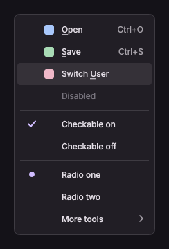

# Material Dark untuk KDE Plasma 6

Tema gelap bergaya **Material Design 3** untuk KDE Plasma 6, dibuat sebagai pasangan dari
[neobrutal-dark-kde](https://github.com/naufalalamsyah453/neobrutal-dark-kde) dengan struktur repo yang sama:
permukaan tonal, bentuk membulat, tanpa outline tebal, dan *state layer* (hover 8%, fokus/tekan 10%)
sebagai pengganti hard shadow.

Dipasang sebagai tema **baru** bernama **"Material Dark"** — tidak menimpa tema yang sudah ada.




## Pemetaan dari Neobrutal ke Material

| Aspek | Neobrutal Dark | Material Dark |
| --- | --- | --- |
| Bentuk | Siku, tanpa sudut membulat | Pill (tombol), 4px (field), 12px (kartu / group box) |
| Garis | Outline krem 2–3px | Outline 1px (*outline variant*), 2px primary saat fokus |
| Kedalaman | Hard shadow kanan-bawah | Permukaan tonal + bayangan lembut (elevation) |
| Aksen | Kuning / pink / biru | Satu warna **primary** `#D0BCFF` (ungu) + tonal |
| Tombol | Timbul, bergeser saat ditekan | Default = *filled*, normal = *tonal*, flat = *text* |
| Hover / tekan | Ganti warna shadow | *State layer* 8% / 10% |
| Tab | Kotak kuning | Teks primary + indikator 3px |
| Slider / progress | Kotak bergaris | Track 4px / pill, handle bulat (Qt dan slider panel Plasma) |
| Context menu | Kotak kuning bergaris | Permukaan tonal, sudut 8px, item hover = state layer 10% (bukan isi primary penuh) |
| Tombol Plasma (Start menu, panel) | Kotak timbul | Tonal / text button pil, hover 8%, tekan = primary 24%, fokus = cincin 2px |
| Titlebar | Kuning, tombol kotak berwarna | Surface tonal, sudut jendela membulat 12px, tombol bulat, close = error |
| Tooltip / preview taskbar | Kuning | Surface gelap `#36343B`, sudut 8px |

Palet dasar (M3 dark): surface `#141218`, surface container `#211F25` / `#2B2930`, on-surface `#E6E0E9`,
primary `#D0BCFF`, on-primary `#381E72`, error `#F2B8B5`.

## Isi Repo

| Path | Keterangan |
| --- | --- |
| `color-schemes/MaterialDark.colors` | Color scheme Plasma/KDE |
| `style/` | Application Style (plugin Qt6 C++), nama **"Material Dark"** (key `materialdesign`) |
| `decoration/` | Window Decoration (plugin KDecoration3 C++), nama **"Material Dark"** |
| `plasma/desktoptheme/material-dark/` | Plasma Style (panel, popup, tooltip, item list, `widgets/button.svg`, `widgets/slider.svg`) |
| `konsole/MaterialDark.colorscheme` | Skema warna Konsole |
| `tools/preview.cpp` | Render galeri widget ke PNG (`-DBUILD_PREVIEW=ON`) |
| `install.sh` / `uninstall.sh` | Pemasang dan penghapus tema |

Warna aksen Application Style dibaca dari `Colors:Window/DecorationFocus` di color scheme aktif,
jadi mengganti color scheme ikut mengganti warna primary.

## Kebutuhan

- KDE Plasma 6, Qt 6, CMake, compiler C++20
- Header pengembangan KDE

Arch Linux:

```bash
sudo pacman -S --needed base-devel cmake extra-cmake-modules \
  qt6-base kcoreaddons kdecoration
```

> Distribusi lain: `qt6-base-devel`, `kf6-kcoreaddons-devel`, `kdecoration-devel`, `extra-cmake-modules`.

## Pasang

```bash
cd material-dark-kde
chmod +x install.sh uninstall.sh
./install.sh            # kompilasi + pasang (sudo)
./install.sh --apply    # sama, lalu langsung diaktifkan
./install.sh --user     # plugin ke ~/.local tanpa sudo (perlu logout/login)
./install.sh --no-build # hanya warna, Plasma Style, Konsole
```

Aktifkan manual di **System Settings → Colors & Themes**: Colors, Plasma Style, Application Style,
dan Window Decorations → "Material Dark". Logout lalu login sekali.

## Hapus / Kembali ke Breeze

Pindahkan dulu ke Breeze di System Settings, lalu `./uninstall.sh`.

## Status Pengujian

- Application Style: **sudah dikompilasi dan dirender offscreen** dengan Qt 6 (lihat gambar di atas).
  Belum diuji menyeluruh di sesi Plasma sungguhan (terutama hover/pressed spinbox dan scrollbar).
- Window Decoration: sudut membulat memakai `setBorderRadius` + `setBorderOutline` (KDecoration3 terbaru, pola yang sama
  dengan Breeze), jadi **butuh Plasma/KWin yang mendukung API tersebut** (Plasma 6.5+). Kode sudah lolos pengecekan
  sintaks terhadap header KDecoration3 master, tetapi belum dijalankan di KWin oleh penulis. Bila tampilan aneh,
  pilih Breeze kembali dan laporkan.
- Plasma Style: SVG sudah divalidasi sebagai XML, belum dilihat di Plasma. Jika sudut popup tampak
  janggal, sesuaikan ukuran elemen di `plasma/desktoptheme/material-dark/widgets/background.svg`.
- Context menu Qt (`QMenu`, termasuk menu "Session" di Start menu): **sudah dirender offscreen** (lihat `preview-menu.png`).
  Sudut bulat memakai latar jendela menu yang tembus (`WA_TranslucentBackground`), jadi butuh compositing (ada di KWin).
  Popup `QComboBox` tetap persegi.
- Tombol dan slider Plasma (`widgets/button.svg`, `widgets/slider.svg`): SVG sudah divalidasi sebagai XML dan penyusunan
  FrameSvg-nya disimulasikan ke PNG, tetapi **belum dilihat di Plasma sungguhan**. Setelah pasang, jalankan
  `kquitapp6 plasmashell; kstart plasmashell`. Warna mengikuti color scheme lewat kelas `ColorScheme-*`.

## Riwayat Perubahan

**1.1**
- Menu: item terpilih tidak lagi berisi warna primary penuh (bawaan Fusion); sekarang state layer 10%. Centang, radio,
  ikon, pintasan, panah submenu digambar ulang; sudut menu bulat; menu bar ikut.
- Plasma Style: tambah `widgets/button.svg` (sebelumnya jatuh ke Breeze sehingga tombol Start menu seperti Session / Sleep
  berbingkai ungu) dan `widgets/slider.svg` (slider volume / kecerahan di panel).
- Tanda skala slider Qt kini terlihat (Fusion menggambarnya hampir sewarna latar gelap).
- Bagian panah `QToolButton` bermenu kini datar, bukan kapsul tonal.

## Lisensi

[MIT](LICENSE) © 2026 naufalalamsyah453
