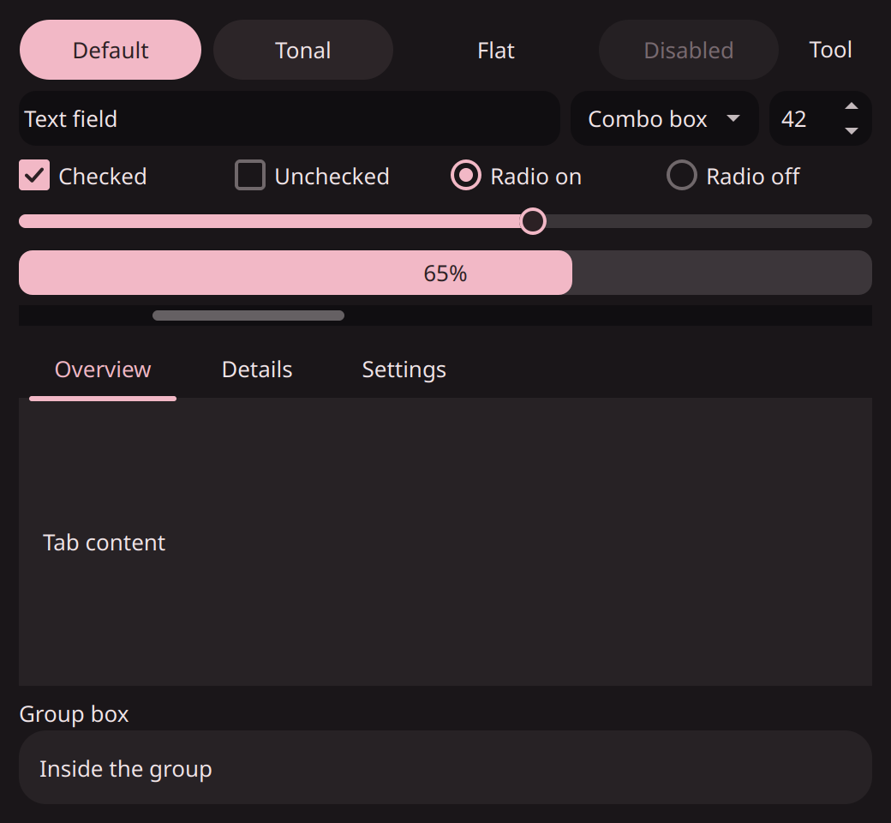

# Material Dark untuk KDE Plasma 6

Tema gelap **Material Design 3** untuk KDE Plasma 6 dengan permukaan *warm charcoal* dan aksen
**pink pastel** — terinspirasi Material You dan tampilan FydeOS di screenshot referensi. Semua
kontrol dibuat membulat: tombol pil, field 10px, kartu 16px, menu 12px, dan *state layer*
(hover 8%, tekan 12–22%) sebagai pengganti outline tebal.

Tersedia dua varian warna dari satu sumber palet:

- **Material Dark** (default) — permukaan *warm charcoal* + aksen pink `#F2B8C6`.
- **Material Dark Blue** — permukaan *cool charcoal* + aksen biru `#A8C7FA`.

Dipasang sebagai tema **baru** — tidak menimpa tema yang sudah ada.




Kontrol Plasma (switch, slider, progress bar, text field):


## Palet

| Peran | Warna |
| --- | --- |
| Primary / aksen | `#F2B8C6` |
| On-primary (teks di atas pink) | `#2B1219` |
| Primary container | `#FFD9E2` |
| Surface (window) | `#1A1619` |
| Surface container (popup/applet) | `#272225` |
| Surface high (tombol) | `#322A2E` |
| Surface highest (track slider) | `#3A3538` |
| View / editor | `#100E11` |
| Teks | `#F0E4E7` |
| Teks nonaktif | `#CDB9BF` |
| Tooltip | `#322A2E` |
| Panel | `#1A1619` |
| Error | `#F2B8B5` |

Varian biru:

| Peran | Warna |
| --- | --- |
| Primary / aksen | `#A8C7FA` |
| On-primary (teks di atas biru) | `#0A305F` |
| Primary container | `#D3E3FD` |
| Surface (window) | `#151A21` |
| Surface container (popup/applet) | `#21262E` |
| Surface high (tombol) | `#2B323C` |
| Surface highest (track slider) | `#343940` |
| View / editor | `#0D1117` |
| Teks | `#E3E8F0` |
| Teks nonaktif | `#B6C0CE` |
| Panel | `#151A21` |

Warna aksen Application Style dibaca dari `Colors:Window/DecorationFocus` di color scheme aktif,
jadi mengganti color scheme (pink ↔ biru) ikut mengganti warna primary, seleksi, dan fokus di
style Qt, QML, dekorasi jendela, serta Plasma Style.

## Sorotan

- **Application Style "Material Dark"** — turunan Fusion (`QProxyStyle`) yang menggambar ulang
  tombol, line edit, combobox, spinbox, checkbox, radio, slider, scrollbar, progress bar, tab,
  header, tooltip, menu, dan seleksi list. Tombol berbentuk pil, hover/tekan memakai *state
  layer* pink, slider memakai track pink dengan knob gelap bercincin.
- **Window Decoration "Material Dark"** — plugin KDecoration3: titlebar surface tonal, sudut
  jendela 6px, tombol bulat dengan jarak 12px, close memakai warna error M3. Tombol maximize
  tidak lagi memakai lingkaran tetap saat jendela maksimal supaya tidak tampak terpotong oleh
  tombol sebelahnya.
- **Plasma Style "Material Dark"** (id `material-dark-kde`) — popup, panel, tooltip, item list,
  tombol, line edit, **slider**, **switch**, **progress bar / OSD volume** senada. Panel
  memakai permukaan `#1A1619`; versi mengambang memakai sudut 9px.
- **Plasma Style "Material Dark Blue"** (id `material-dark-kde-blue`) — aset yang sama,
  diregenerasi dari palet biru.
- **Color scheme + Konsole** — skema gelap hangat dengan teks krem dan aksen pink, plus
  pasangan biru dingin; ANSI yellow/blue tetap fungsional agar output terminal tetap terbaca.
- **Seleksi nonaktif** — saat jendela tidak aktif, pil seleksi memakai aksen gelap (bukan pink
  penuh) sehingga teks terang dari delegate seperti sidebar Dolphin tetap terbaca.

## Pemetaan gaya

| Aspek | Material Dark |
| --- | --- |
| Bentuk | Pil (tombol), 10px (field), 12px (menu), 16px (kartu / dialog) |
| Garis | Tanpa outline (permukaan tonal terang-gelap antar section); 2px primary saat fokus |
| Kedalaman | Permukaan tonal + bayangan lembut (elevation) |
| Hover / tekan | *State layer* 8% / 12%; tombol aktif/checked = pink 22% |
| Tab | Teks primary + indikator |
| Slider | Track 8px pink, knob gelap `#2B1219` dengan cincin primary |
| Switch | Track pil pink saat aktif, knob gelap, ring fokus pink |
| Context menu | Permukaan tonal, sudut 12px, item hover = *state layer* |
| Titlebar | Surface tonal, sudut jendela 6px, tombol bulat, close = error |
| Tooltip | Surface `#322A2E`, sudut 5px (Plasma) |
| Bayangan | Shell (menu, OSD, tooltip, panel mengambang) memakai shadow native Plasma di luar window; kontrol dalam window tidak |

## Isi Repo

| Path | Keterangan |
| --- | --- |
| `color-schemes/MaterialDark.colors` | Color scheme Plasma/KDE (pink) |
| `color-schemes/MaterialDarkBlue.colors` | Color scheme Plasma/KDE (biru) |
| `style/` | Application Style (plugin Qt6 C++), nama **"Material Dark"** (key `materialdesign`) |
| `decoration/` | Window Decoration (plugin KDecoration3 C++), nama **"Material Dark"** |
| `plasma/desktoptheme/material-dark-kde/` | Plasma Style pink (panel, popup, tooltip, item list, slider, switch, progress bar, line edit) |
| `plasma/desktoptheme/material-dark-kde-blue/` | Plasma Style biru |
| `konsole/MaterialDark.colorscheme` | Skema warna Konsole (pink) |
| `konsole/MaterialDarkBlue.colorscheme` | Skema warna Konsole (biru) |
| `tools/preview.cpp` | Render galeri widget ke PNG (`-DBUILD_PREVIEW=ON`) |
| `tools/gen-plasma-assets.py` | Generator SVG Plasma + color scheme + Konsole untuk kedua varian |
| `install.sh` / `uninstall.sh` | Pemasang dan penghapus tema |

## Kebutuhan

- KDE Plasma 6, Qt 6, CMake, compiler C++20
- Header pengembangan KDE

Arch Linux:

```bash
sudo pacman -S --needed base-devel cmake extra-cmake-modules \
  qt6-base kcoreaddons kdecoration
```

> Distribusi lain: `qt6-base-devel`, `kf6-kcoreaddons-devel`, `kdecoration-devel`, `extra-cmake-modules`.

## Pasang

```bash
cd material-dark-kde
chmod +x install.sh uninstall.sh
./install.sh              # kompilasi + pasang (sudo), kedua varian
./install.sh --apply      # sama, lalu aktifkan varian pink
./install.sh --apply --blue   # sama, lalu aktifkan varian biru
./install.sh --variant blue   # pasang kedua varian, aktifkan biru nanti secara manual
./install.sh --user       # plugin ke ~/.local tanpa sudo (perlu logout/login)
./install.sh --no-build   # hanya warna, Plasma Style, Konsole
```

Aktifkan manual di **System Settings → Colors & Themes**: Colors dan Plasma Style →
"Material Dark" atau "Material Dark Blue"; Application Style dan Window Decorations →
"Material Dark" (warna mengikuti color scheme). Logout lalu login sekali.

Konsole: **Settings → Edit Current Profile → Appearance** → "Material Dark" atau
"Material Dark Blue".

## Hapus / Kembali ke Breeze

Pindahkan dulu ke Breeze di System Settings, lalu `./uninstall.sh`.

## Status Pengujian

- Application Style: sudah dikompilasi dan dirender offscreen dengan Qt 6 (lihat gambar di atas).
- Window Decoration: memakai `setBorderRadius` + `setBorderOutline` (KDecoration3, pola yang sama
  dengan Breeze), butuh Plasma/KWin 6.5+. Bila tampil aneh, pilih Breeze kembali dan laporkan.
- Plasma Style: seluruh SVG tervalidasi XML dan sudah diuji di sesi Plasma 6.8 (slider, switch,
  progress bar/OSD volume, popup, tooltip). Cache Plasma dihapus otomatis oleh `install.sh`.
- Context menu Qt (`QMenu`): dirender offscreen (lihat `preview-menu.png`); sudut bulat butuh
  compositing KWin. Popup `QComboBox` mengikuti radius field.
- Aplikasi QML/Kirigami yang memakai style Breeze untuk kontrol QQC2 tetap mengikuti warna color
  scheme (gelap, teks krem, fokus pink, seleksi pink), tetapi bentuk pil hanya berlaku pada
  kontrol QtWidgets dan komponen Plasma.

## Riwayat Perubahan

**1.3.4**
- **Lingkaran hover tombol judul tidak lagi terpotong**: state layer (lingkaran hover/tekan pada
  close, minimize, maximize) sekarang diinset 2px di dalam sel tombol 24px. Sebelumnya lingkaran
  digambar persis sebesar sel, jadi tepinya menempel ke batas sel dan tampak terpotong oleh tombol
  sebelahnya atau tepi titlebar — terutama pada jarak antar tombol 12px. Ikon tetap di tengah,
  hanya lingkarannya yang lebih kecil. **Perlu logout/login** karena KWin menyimpan plugin
  dekorasi yang sudah dimuat; mengganti dekorasi saat sesi berjalan tidak memuat ulang kode plugin.

**1.3.3**
- **Sudut bersih di atas wallpaper**: mask window Plasma (`mask-*`) sekarang dibuat dengan radius yang sama dengan body frame, bukan menyalin mask 6px dari tema default. Selisih radius 10px vs 6px meninggalkan celah transparan tipis di sudut; di atas wallpaper celah itu terlihat sebagai gerigi ungu terang, dan hilang saat jendela lain menutupinya. Dengan mask yang sesuai, tepi body dan shape window menyatu, sehingga sudut tetap halus di atas wallpaper maupun aplikasi.
- Panel tetap memakai alpha frame-nya sendiri: panel menempel rata ke tepi, sedangkan panel mengambang mengikuti pil 9px.

**1.3.2**
- **Bayangan shell kembali ke mekanisme native Plasma**: app menu, popup applet, OSD, tooltip,
  dan panel mengambang kini memakai elemen `shadow-*` + `mask-*` + `shadow-hint-*`. Mask dibuat
  sesuai radius body; Plasma menggambar bayangan **di luar** window, jadi tepi popup tidak lagi
  berupa pita gelap dengan batas keras seperti pada 1.3.1; isi popup juga tidak bergeser karena
  tidak ada padding bayangan yang ditanam.
- **Sudut tidak lagi bergerigi pada fractional scaling**: semua SVG hasil generator sekarang
  menyertakan `viewBox`, sehingga Plasma merasterisasi pada rasio perangkat (mis. 1.5×) alih-alih
  merentangkan gambar 1×. Busur sudut dan bayangan jadi halus.
- **Variasi solid panel** tidak lagi memuat pil mengambang/bayangan yang terpotong; panel solid
  tetap rata ke tepi layar.
- Tombol judul jendela memakai jarak 12px; lingkaran hover tidak lagi tampak terpotong oleh
  tombol sebelahnya (perlu logout/login agar plugin dekorasi KWin yang baru dimuat).

**1.3.1**
- **Bayangan pada permukaan shell**: app menu / popup Plasma, OSD, tooltip, dan panel mengambang
  kini punya *drop shadow* lembut 8–10px yang mengikuti sudut membulat. Bayangan ditanam di
  padding frame 9-slice, jadi ukuran dan tata letak isi popup tidak berubah. Jendela tetap
  memakai shadow dekorasi KWin (24px). Kontrol **di dalam window** (tombol, input, kartu, menu
  konteks) tidak diberi shadow. Mekanisme ini digantikan oleh pendekatan native di 1.3.2.

**1.3.0**
- **Varian biru**: color scheme `MaterialDarkBlue`, Konsole `MaterialDarkBlue`, dan Plasma Style
  `material-dark-kde-blue` dengan aksen `#A8C7FA` di atas permukaan cool charcoal. Pasang/aktifkan
  lewat `./install.sh --apply --blue` atau `--variant blue`.
- **Radius dipotong 50% khusus permukaan shell**: sudut jendela 12→6px, app menu/dialog Plasma
  20→10px, item menu & taskbar 8→4px, field/search app menu 8→4px, panel mengambang 18→9px,
  tombol Plasma 14→7px, tooltip 10→5px, dan OSD ikut dialog 10px. Kontrol **di dalam window**
  (field, tombol, kartu, menu konteks, item list) tetap membulat seperti sebelumnya: 10/12/16px.
  Bentuk pil dan lingkaran (`height/2`) tetap bulat.
- **Seleksi nonaktif**: pil seleksi item view tidak lagi memakai pink penuh saat jendela tidak
  aktif. Aksen diturunkan nilainya dan saturasinya dinaikkan (`#6E3D49` untuk pink, `#344A6E`
  untuk biru) sehingga teks terang seperti sidebar Dolphin tetap kontras.
- **Dekorasi jendela**: tombol maximize tidak lagi menggambar lingkaran *state layer* permanen
  saat jendela maksimal; ikon restore sudah cukup dan tombol tidak tampak terpotong.
- Generator `tools/gen-plasma-assets.py` kini menjadi satu sumber untuk kedua varian: SVG Plasma,
  color scheme, tema Plasma, dan Konsole sekaligus. Nilai pink lama tetap identik.
- Editor teks tanpa bingkai di dalam widget lain (bar lokasi) tidak lagi menggambar persegi hitam di luar sudut bulat.
- Style Qt Quick Controls `MaterialDark` (`qml/MaterialDark/`): Switch, CheckBox, RadioButton, Slider, SpinBox, ToolButton, ComboBox (field + popup), dan Button
  untuk halaman QML (System Settings > Display, dialog Kirigami) kini sama bentuknya dengan
  widget Qt dan Plasma. Aktif lewat `./install.sh --apply` (env `QT_QUICK_CONTROLS_STYLE`, fallback
  `org.kde.desktop`); perlu logout/login.
- Panah combobox/spinbox: segitiga tetap 8x4px, tidak lagi membesar di spinbox.
- Tool button berteks berbentuk pil seperti tombol biasa.
- Warna disatukan antara app style (C++/QML) dan tema Plasma (SVG): field = Colors:View (#100E11), hover/fokus field
  = Base + 6% teks, section/menu/group box = #272225 (sama dengan dialog Plasma), track slider/switch = #3A3538,
  panel Plasma = warna Window, state tombol tertekan/fokus Plasma = lapisan teks netral 10% (bukan pink).

**1.2.2**
- App menu, popup applet taskbar, serta OSD volume dan brightness kini punya border tipis
  1px `#453F42` — warna dan ketebalan yang sama dengan outline context menu Qt.
- Panel mengambang dan tooltip memakai border yang sama; panel yang menempel ke tepi layar
  tetap tanpa border agar tidak terlihat dobel di sisi layar.

**1.2.1**
- App menu / popup Plasma kembali punya permukaan solid: `widgets/background.svg` dan
  `dialogs/background.svg` kini menyediakan elemen tanpa prefix yang dicari Plasma 6.8
  (sebelumnya menu tampil transparan). Sudut dialog 20px, popup 16px.
- Padding popup diperbesar (dialog 20px, popup 16px) supaya baris header app menu tidak lagi
  menempel ke border.
- Field/search Plasma: outline abu-abu saat idle dihapus. Fokus kini satu cincin pink 2px
  yang presisi di tepi field, tanpa cincin dalam atau halo; hover memakai permukaan tonal.
  Radius field Plasma 8px (Qt 10px), lapisan fokus digambar di atas base lewat
  `hint-focus-over-base`.
- Context menu Qt lebih ringkas: tinggi item 32→28px, padding horizontal 12→10px, margin
  menu 4/6→3/4px, kolom centang 24→20px, jarak ikon 8→6px, pemisah 9→7px.

**1.2.0**
- Palet baru: seluruh aksen ungu M3 (`#D0BCFF`) diganti pink pastel `#F2B8C6` dengan permukaan
  warm charcoal. Color scheme, Konsole, dan fallback di style/dekorasi ikut diselaraskan.
- Plasma Style: tambah `widgets/switch.svg`, `widgets/bar_meter_horizontal.svg`,
  `widgets/bar_meter_vertical.svg`, dan `widgets/lineedit.svg` agar toggle, OSD volume,
  progress bar, dan field Plasma tidak lagi jatuh ke Breeze.
- Radius diperbesar: field 4→10px, kartu/group box 12→16px, menu 8→12px, tool button 8→10px.
- Slider: track 8px pink, knob gelap dengan cincin primary (Qt dan Plasma), switch knob gelap.
- Panel mengambang memakai sudut 18px; dialog 16px; tooltip 8px.
- Tombol Plasma yang aktif/checked kini memakai *state layer* pink 22%.
- Panel Plasma memperbaiki struktur `panel-background.svg`: elemen tanpa prefix untuk panel
  menempel (edge-to-edge) dan prefix `floating` untuk panel mengambang, plus salinan
  `solid/widgets/panel-background.svg` untuk mode opaque. Sebelumnya panel tampil transparan
  karena Plasma 6 mencari elemen tanpa prefix.
- Id Plasma Style dibuat `material-dark-kde` agar tidak menimpa tema "Material Dark" lain
  yang sudah ada di sistem; nama yang tampil tetap **Material Dark**.
- Tambah generator `tools/gen-plasma-assets.py` supaya seluruh aset Plasma bisa diregenerasi
  dari satu palet.
- Preview baru: galeri widget, menu, dan kontrol Plasma.

**1.1**
- Rilis awal: color scheme, Application Style, Window Decoration, Plasma Style, dan Konsole.

## Lisensi

[MIT](LICENSE) © 2026 naufalalamsyah453
