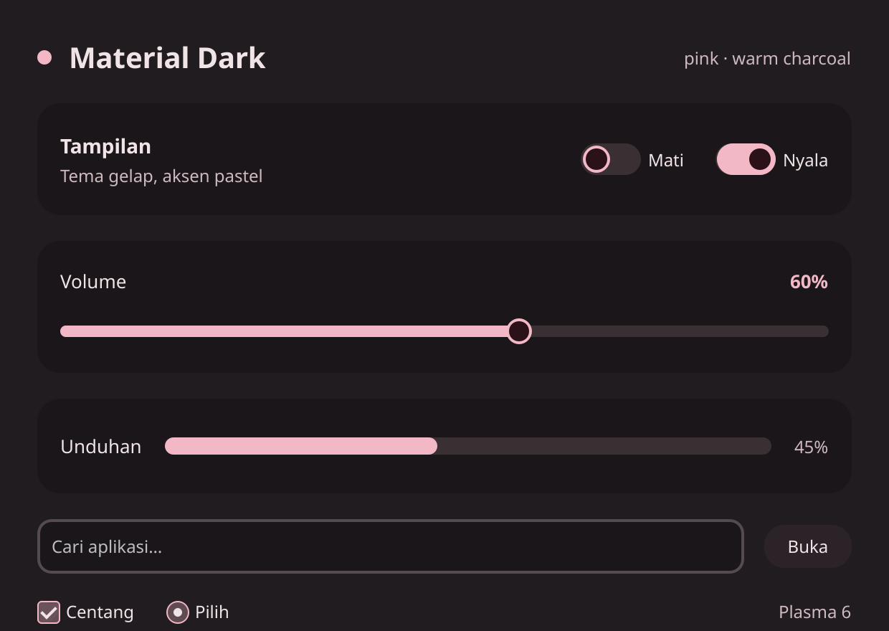

# Material Dark untuk KDE Plasma 6

Tema gelap **Material Design 3** untuk KDE Plasma 6 dengan permukaan *warm charcoal* dan aksen
**pink pastel** — terinspirasi Material You dan tampilan FydeOS di screenshot referensi. Semua
kontrol dibuat membulat: tombol pil, field 10px, kartu 16px, menu 12px, dan *state layer*
(hover 8%, tekan 12–22%) sebagai pengganti outline tebal.

Dipasang sebagai tema **baru** bernama **"Material Dark"** — tidak menimpa tema yang sudah ada.


Kontrol Plasma (switch, slider, progress bar, text field):



## Palet

| Peran | Warna |
| --- | --- |
| Primary / aksen | `#F2B8C6` |
| On-primary (teks di atas pink) | `#2B1219` |
| Primary container | `#FFD9E2` |
| Surface (window) | `#1A1619` |
| Surface container (popup/applet) | `#211C1F` |
| Surface high (tombol) | `#2C2528` |
| Surface highest (track slider) | `#3A3034` |
| View / editor | `#100E11` |
| Teks | `#F0E4E7` |
| Teks nonaktif | `#CDB9BF` |
| Tooltip | `#322A2E` |
| Panel | `#161114` |
| Error | `#F2B8B5` |

Warna aksen Application Style dibaca dari `Colors:Window/DecorationFocus` di color scheme aktif,
jadi mengganti color scheme ikut mengganti warna primary.

## Sorotan

- **Application Style "Material Dark"** — turunan Fusion (`QProxyStyle`) yang menggambar ulang
  tombol, line edit, combobox, spinbox, checkbox, radio, slider, scrollbar, progress bar, tab,
  header, tooltip, menu, dan seleksi list. Tombol berbentuk pil, hover/tekan memakai *state
  layer* pink, slider memakai track pink dengan knob gelap bercincin.
- **Window Decoration "Material Dark"** — plugin KDecoration3: titlebar surface tonal, sudut
  jendela 12px, tombol bulat, close memakai warna error M3.
- **Plasma Style "Material Dark"** (id `material-dark-kde`) — popup, panel, tooltip, item list,
  tombol, line edit, **slider**, **switch**, **progress bar / OSD volume** senada. Panel
  memakai permukaan `#161114`; versi mengambang memakai sudut 18px.
- **Color scheme + Konsole** — satu skema gelap hangat dengan teks krem dan aksen pink; ANSI
  yellow/blue tetap fungsional agar output terminal tetap terbaca.

## Pemetaan gaya

| Aspek | Material Dark |
| --- | --- |
| Bentuk | Pil (tombol), 10px (field), 12px (menu), 16px (kartu / dialog) |
| Garis | Tanpa outline (permukaan tonal terang-gelap antar section); 2px primary saat fokus |
| Kedalaman | Permukaan tonal + bayangan lembut (elevation) |
| Hover / tekan | *State layer* 8% / 12%; tombol aktif/checked = pink 22% |
| Tab | Teks primary + indikator |
| Slider | Track 8px pink, knob gelap `#2B1219` dengan cincin primary |
| Switch | Track pil pink saat aktif, knob gelap, ring fokus pink |
| Context menu | Permukaan tonal, sudut 12px, item hover = *state layer* |
| Titlebar | Surface tonal, sudut jendela 12px, tombol bulat, close = error |
| Tooltip | Surface `#322A2E`, sudut 8px |

## Isi Repo

| Path | Keterangan |
| --- | --- |
| `color-schemes/MaterialDark.colors` | Color scheme Plasma/KDE |
| `style/` | Application Style (plugin Qt6 C++), nama **"Material Dark"** (key `materialdesign`) |
| `decoration/` | Window Decoration (plugin KDecoration3 C++), nama **"Material Dark"** |
| `plasma/desktoptheme/material-dark-kde/` | Plasma Style (panel, popup, tooltip, item list, slider, switch, progress bar, line edit) |
| `konsole/MaterialDark.colorscheme` | Skema warna Konsole |
| `tools/preview.cpp` | Render galeri widget ke PNG (`-DBUILD_PREVIEW=ON`) |
| `tools/gen-plasma-assets.py` | Generator SVG Plasma dari palet di atas |
| `install.sh` / `uninstall.sh` | Pemasang dan penghapus tema |

## Kebutuhan

- KDE Plasma 6, Qt 6, CMake, compiler C++20
- Header pengembangan KDE

Arch Linux:

```bash
sudo pacman -S --needed base-devel cmake extra-cmake-modules \
  qt6-base kcoreaddons kdecoration
```

> Distribusi lain: `qt6-base-devel`, `kf6-kcoreaddons-devel`, `kdecoration-devel`, `extra-cmake-modules`.

## Pasang

```bash
cd material-dark-kde
chmod +x install.sh uninstall.sh
./install.sh            # kompilasi + pasang (sudo)
./install.sh --apply    # sama, lalu langsung diaktifkan
./install.sh --user     # plugin ke ~/.local tanpa sudo (perlu logout/login)
./install.sh --no-build # hanya warna, Plasma Style, Konsole
```

Aktifkan manual di **System Settings → Colors & Themes**: Colors, Plasma Style, Application Style,
dan Window Decorations → "Material Dark". Logout lalu login sekali.

## Hapus / Kembali ke Breeze

Pindahkan dulu ke Breeze di System Settings, lalu `./uninstall.sh`.

## Status Pengujian

- Application Style: sudah dikompilasi dan dirender offscreen dengan Qt 6 (lihat gambar di atas).
- Window Decoration: memakai `setBorderRadius` + `setBorderOutline` (KDecoration3, pola yang sama
  dengan Breeze), butuh Plasma/KWin 6.5+. Bila tampil aneh, pilih Breeze kembali dan laporkan.
- Plasma Style: seluruh SVG tervalidasi XML dan sudah diuji di sesi Plasma 6.8 (slider, switch,
  progress bar/OSD volume, popup, tooltip). Cache Plasma dihapus otomatis oleh `install.sh`.
- Context menu Qt (`QMenu`): dirender offscreen (lihat `preview-menu.png`); sudut bulat butuh
  compositing KWin. Popup `QComboBox` mengikuti radius field.
- Aplikasi QML/Kirigami yang memakai style Breeze untuk kontrol QQC2 tetap mengikuti warna color
  scheme (gelap, teks krem, fokus pink, seleksi pink), tetapi bentuk pil hanya berlaku pada
  kontrol QtWidgets dan komponen Plasma.

## Riwayat Perubahan

**1.3.0**
- Editor teks tanpa bingkai di dalam widget lain (bar lokasi) tidak lagi menggambar persegi hitam di luar sudut bulat.
- Style Qt Quick Controls `MaterialDark` (`qml/MaterialDark/`): Switch, ComboBox (field + popup), dan Button
  untuk halaman QML (System Settings > Display, dialog Kirigami) kini sama bentuknya dengan
  widget Qt dan Plasma. Aktif lewat `./install.sh --apply` (env `QT_QUICK_CONTROLS_STYLE`, fallback
  `org.kde.desktop`); perlu logout/login.
- Panah combobox/spinbox: segitiga tetap 8x4px, tidak lagi membesar di spinbox.
- Tool button berteks berbentuk pil seperti tombol biasa.

**1.2.2**
- App menu, popup applet taskbar, serta OSD volume dan brightness kini punya border tipis
  1px `#453F42` — warna dan ketebalan yang sama dengan outline context menu Qt.
- Panel mengambang dan tooltip memakai border yang sama; panel yang menempel ke tepi layar
  tetap tanpa border agar tidak terlihat dobel di sisi layar.

**1.2.1**
- App menu / popup Plasma kembali punya permukaan solid: `widgets/background.svg` dan
  `dialogs/background.svg` kini menyediakan elemen tanpa prefix yang dicari Plasma 6.8
  (sebelumnya menu tampil transparan). Sudut dialog 20px, popup 16px.
- Padding popup diperbesar (dialog 20px, popup 16px) supaya baris header app menu tidak lagi
  menempel ke border.
- Field/search Plasma: outline abu-abu saat idle dihapus. Fokus kini satu cincin pink 2px
  yang presisi di tepi field, tanpa cincin dalam atau halo; hover memakai permukaan tonal.
  Radius field Plasma 8px (Qt 10px), lapisan fokus digambar di atas base lewat
  `hint-focus-over-base`.
- Context menu Qt lebih ringkas: tinggi item 32→28px, padding horizontal 12→10px, margin
  menu 4/6→3/4px, kolom centang 24→20px, jarak ikon 8→6px, pemisah 9→7px.

**1.2.0**
- Palet baru: seluruh aksen ungu M3 (`#D0BCFF`) diganti pink pastel `#F2B8C6` dengan permukaan
  warm charcoal. Color scheme, Konsole, dan fallback di style/dekorasi ikut diselaraskan.
- Plasma Style: tambah `widgets/switch.svg`, `widgets/bar_meter_horizontal.svg`,
  `widgets/bar_meter_vertical.svg`, dan `widgets/lineedit.svg` agar toggle, OSD volume,
  progress bar, dan field Plasma tidak lagi jatuh ke Breeze.
- Radius diperbesar: field 4→10px, kartu/group box 12→16px, menu 8→12px, tool button 8→10px.
- Slider: track 8px pink, knob gelap dengan cincin primary (Qt dan Plasma), switch knob gelap.
- Panel mengambang memakai sudut 18px; dialog 16px; tooltip 8px.
- Tombol Plasma yang aktif/checked kini memakai *state layer* pink 22%.
- Panel Plasma memperbaiki struktur `panel-background.svg`: elemen tanpa prefix untuk panel
  menempel (edge-to-edge) dan prefix `floating` untuk panel mengambang, plus salinan
  `solid/widgets/panel-background.svg` untuk mode opaque. Sebelumnya panel tampil transparan
  karena Plasma 6 mencari elemen tanpa prefix.
- Id Plasma Style dibuat `material-dark-kde` agar tidak menimpa tema "Material Dark" lain
  yang sudah ada di sistem; nama yang tampil tetap **Material Dark**.
- Tambah generator `tools/gen-plasma-assets.py` supaya seluruh aset Plasma bisa diregenerasi
  dari satu palet.
- Preview baru: galeri widget, menu, dan kontrol Plasma.

**1.1**
- Rilis awal: color scheme, Application Style, Window Decoration, Plasma Style, dan Konsole.

## Lisensi

[MIT](LICENSE) © 2026 naufalalamsyah453
